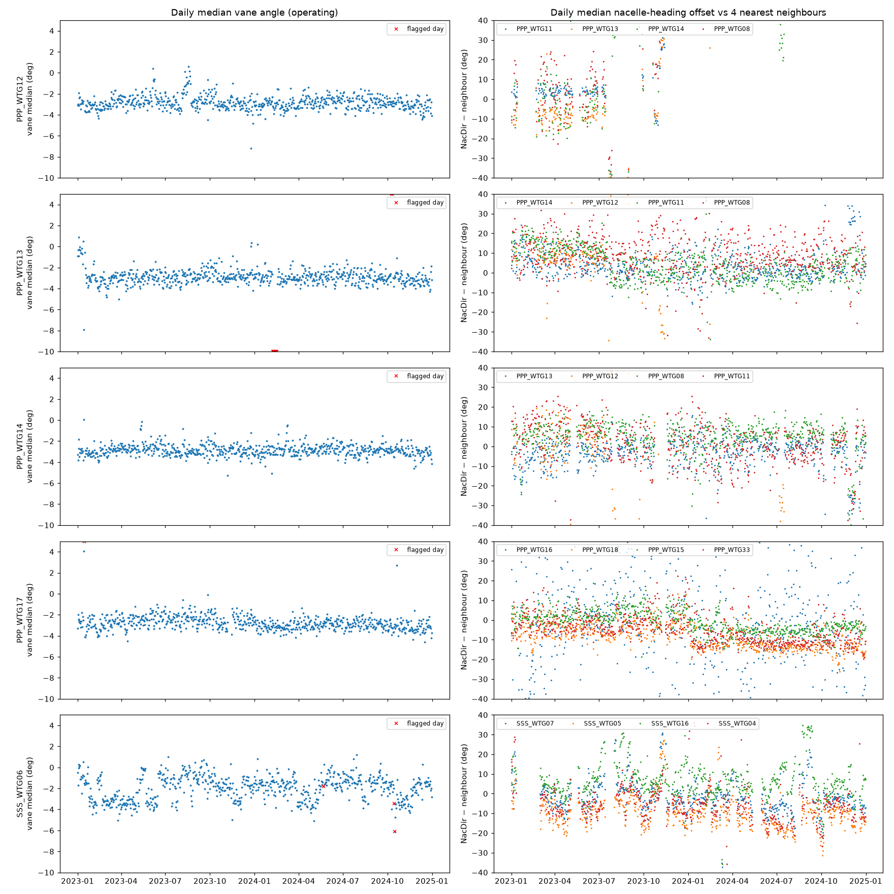
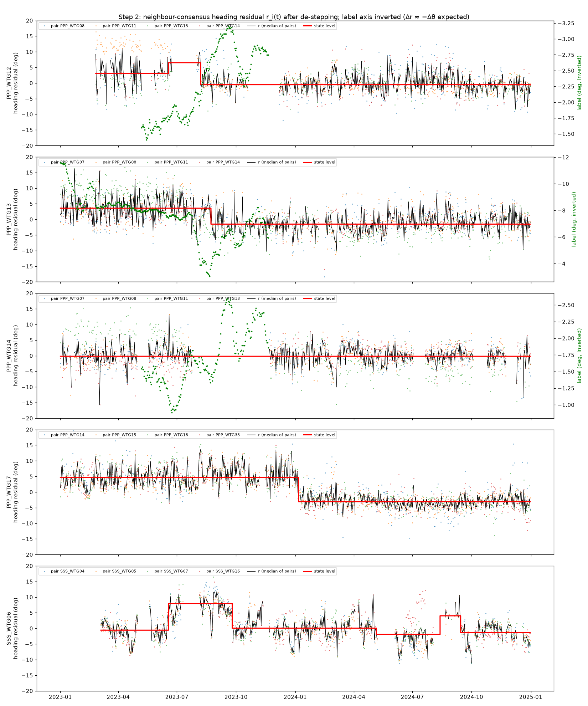
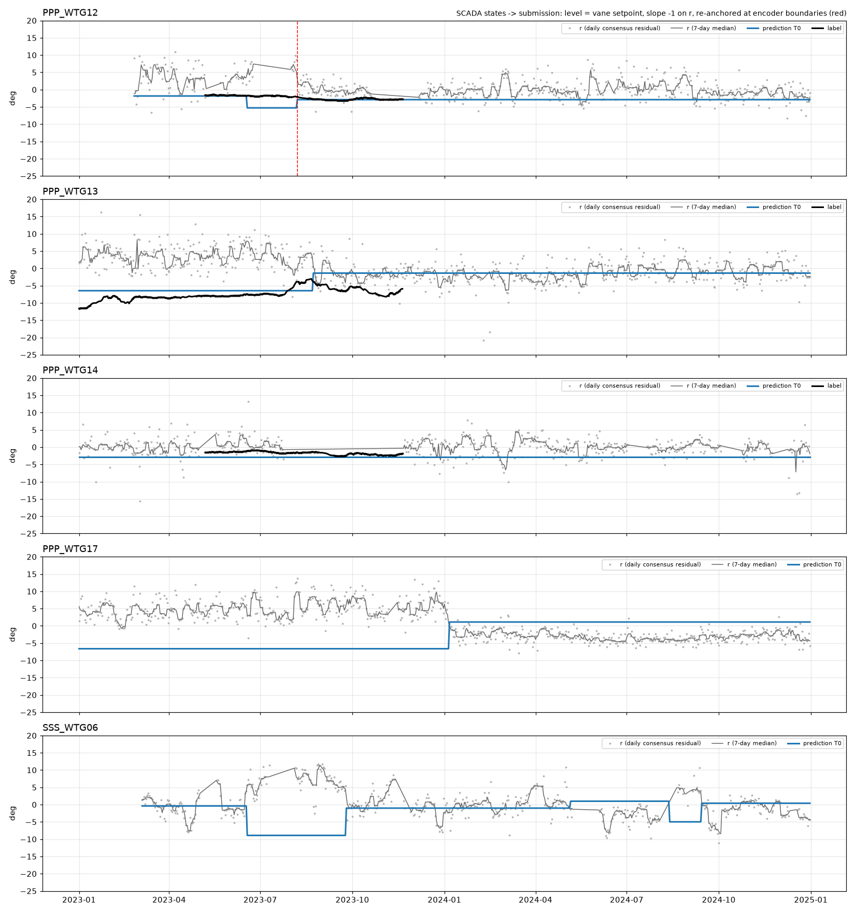

# Participant 33 — T0 method (label-free)

Method, code and theory behind `submissions/Results_33_T0_0.csv` (PPP_WTG17) and `submissions/Results_33_T0_final.csv`
(SSS_WTG06). Both files come from the same model with no fitted parameter:

$$
\hat\theta(d) \;=\; L \;-\; \big(\bar r_{\ell(d)} - \alpha_{\mathrm{seg}(\ell(d))}\big)
$$

| Symbol | Meaning | Source |
|----|----------------------|--------|
| $\hat\theta(d)$ | predicted static yaw misalignment on day $d$ | |
| $\ell(d)$ | the day's state; submitted as `cluster` | change points of $r$ (§3) |
| $\bar r_\ell$ | level of the neighbour heading residual in state $\ell$ | §2 |
| $\alpha_{\mathrm{seg}}$ | anchor: day-weighted mean of $\bar r_\ell$ over an encoder-free segment | §4 |
| $L$ | level prior: the turbine's vane set-point | §4 |

In words: the *changes* of the misalignment are read from how the nacelle
heading moves against its neighbours, with a slope of exactly −1 that follows
from the sensor algebra; the *level* is taken from the vane set-point.

## 1. Sensor model

Unobserved: true wind direction $W$, true nacelle heading $N$, yaw error
$\gamma = W - N$ (wrapped to ±180°). The SCADA stream reports

$$
N_r = N + \delta_n, \qquad v = g\,\gamma + \delta_v, \qquad W_r = N_r + v .
$$

- $\delta_n$: the nacelle encoder has no north reference. It is an arbitrary
  constant that jumps whenever the encoder is re-referenced.
- $v$: the vane reads the yaw error with a mounting offset $\delta_v$ and a gain
  $g \le 1$ (we use $g = 1$; it cannot be measured from this data).
- The third equation is how the data set is encoded, not an assumption: the vane
  is recovered as `vane = wrap(WindDir − NacDir)`, so `WindDir` carries the
  encoder offset and only the vane is encoder-free.

**Source.** The heading equation is the nacelle-position model of TNO report
2020 R11206, §3.4 (C. Stock-Williams, D. Wouters, M. Maj, *Investigation into
automating wind turbine underperformance detection using social statistics*,
TNO, Petten, 2020,
[PDF](https://publications.tno.nl/publication/34637217/7RLl98/TNO-2020-R11206.pdf)):
$\Theta = \theta_{\mathrm{local}} + \delta\Theta_m + \delta\Theta_c + \varepsilon$,
with $\delta\Theta_c = \delta_n$ and $\delta\Theta_m = -\gamma$ (the report
counts misalignment as heading minus wind). The same section takes
$\delta\Theta_c$ as piecewise constant between step changes at maintenance,
works with heading differences between turbine pairs, and shows that
miscalibration and misalignment cannot be separated from those differences
without an independent reference; §2 builds on all three.

The complete algebra as used here (vane equation, a controller that nulls the
measured vane, a level that is not identifiable and a change that is, slope
fixed and not fitted) and the consensus residual of §2 are from Participant 50's
T1_T2_T3 solution in this challenge. §9 lists who did what.

The yaw controller rotates the nacelle until the filtered vane sits at its
set-point $s$, so in steady state $E[v] = s$ and

$$
\theta \;\equiv\; E[\gamma] \;=\; \frac{s - \delta_v}{g} .
$$

$\theta$ is the static misalignment: the persistent yaw error the controller
cannot see, because it sits inside its own measurement.

**Consequence: the vane cannot see $\theta$.** Averaged over a day the vane
reads $s$ whatever $\theta$ is. The left column below shows it: the daily median
vane is flat at about −3° on every PPP turbine. Information about $\theta$ has
to come from an external direction reference, and the neighbours provide one
(right column: heading differences against the four nearest turbines, before any
cleaning).



## 2. The neighbour heading residual

Let $c = W + \kappa$ be a consensus of the wind direction from the neighbours,
with $\kappa$ a constant made of the neighbours' own offsets. Then

$$
N_r - c \;=\; N + \delta_n - W - \kappa \;=\; -\gamma + \delta_n - \kappa ,
$$

and averaged over a day

$$
r(d) = -\theta(d) + \delta_n(d) - \kappa
\qquad\Longrightarrow\qquad
\Delta r = -\Delta\theta \quad \text{whenever } \Delta\delta_n = 0 .
$$

So the residual gives **changes** of the misalignment in physical degrees, with
slope −1, independent of the vane and of any power model. Its **level** is not
identifiable, because $\delta_n$ and $\kappa$ are unknown constants.

How $r$ is built (10-minute aggregates, circular statistics throughout):

1. **Pair series.** For turbine $i$ and each of its 4 nearest same-site
   neighbours $j$: $D_{ij} = \mathrm{wrap}(N_r^i - N_r^j)$, in bins where both
   turbines operate. PPP_WTG12 and PPP_WTG16 have unstable headings and are
   excluded as neighbours by hand.
2. **Encoder frames.** A shift of $i$'s encoder frame moves $D_{ij}$ against
   *all* neighbours by the same amount on the same day. Jumps of at least 25°
   with the same sign in at least 60 % of the pairs within ±3 days are credited
   to the encoder and cut the record into intervals. Most of them are not
   re-references but **excursions**: the heading reads about 100° off for two
   weeks and returns. Subtracting an estimated jump out and another one back
   leaves their difference (1° to 30°) in $r$, so no jump estimate is
   subtracted for them:
   - intervals shorter than 45 days are excursions and are dropped, with ±3
     days around every step;
   - between two consecutive long intervals the shift is measured locally
     (first 40 days after minus last 40 days before, median over neighbours).
     Below 15° the frame came back and nothing is corrected; above it the
     shift is a re-reference, is subtracted, and marks an encoder boundary.
3. **Transient removal.** Days more than 10° from the pair's rolling
   median over 91 days with data are dropped. A rolling median keeps a level shift of any size but
   not a pulse shorter than half the window, so this removes the short
   excursions, of either turbine, that are too small to be credited in step 2.
   The price: a real state shorter than about 45 days that departs by more
   than 10° would be removed too.
4. **Sector correction.** Terrain and wakes make the heading difference depend
   on wind direction, so the median of $D_{ij}$ per 30° sector of the
   *neighbour's* wind direction is subtracted. This absorbs the neighbour's own
   offsets into $\kappa$.
5. **Robust daily value.** Median over the bins of the day per pair (a day
   needs at least 12 bins), then median over pairs: $r_i(d)$. A pair with an
   unusually noisy residual is left out. Day-to-day noise is about 2°.



Coloured dots are the individual pairs, the black line is $r$, the red line the
state levels of §3. On the three training turbines the label is drawn in green
on an inverted axis, so $r$ and the label should move together.

## 3. States

$r$ is smoothed with a centred 7-day rolling median and segmented with PELT
(squared-error cost, penalty 400, minimum state length 14 days). The penalty
means a jump $J$ lasting $n$ days on both sides is accepted when
$nJ^2/2 \gtrsim 400$, e.g. 2.4° over 140 days or 5° over 30 days. Each state
gets the median of the smoothed $r$ as its level $\bar r_\ell$.

A boundary with a jump above 15°, or within 10 days of a re-reference verified
in step 2, is typed as an **encoder** boundary. $r$ is not comparable across
such a boundary.

The states are computed from the SCADA residual over all 731 days, with no
knowledge of the template or of which days are scored. They are the `cluster`
column.

## 4. Level: vane set-point and anchor

No label-free estimator of the absolute level survived testing. Locating the
peak of the power-versus-yaw curve fails because over the controller's ±8°
deadband the power changes by only about 2 % ($\cos^2$ model), the same order
as sector, turbulence and season effects.

The level is therefore a prior. Assuming an unbiased vane ($\delta_v = 0$,
$g = 1$), $\theta = s$, and $s$ is measured as

$$
L = \mathrm{median}_{d\ \text{healthy}}\ \big(\text{daily median vane in operation}\big).
$$

The prior describes the turbine's *typical* state, so the state levels are
centred before the slope is applied. Within each encoder-free segment (a run of
states with no encoder boundary) the anchor $\alpha$ is the day-weighted mean of
the state levels. Re-anchoring per segment stops an undetected re-reference from
leaking into the predictions.



Blue is the prediction, grey the residual it is derived from, black the label
where it exists (training turbines only). Red dashed lines are encoder
boundaries.

## 5. What was submitted

| File | Turbine | States | Predicted levels |
|---------|------|-----------|----------|
| `Results_33_T0_0.csv` | PPP_WTG17 | 2 (boundary 2024-01-06, $\Delta r = -7.74°$) | −6.6° then +1.1° |
| `Results_33_T0_final.csv` | SSS_WTG06 | 6, in 1 encoder-free segment | −8.9° … +1.0°, mean −1.6° |

The six levels on SSS_WTG06 are −0.4° (to 2023-06-17), −8.9° (to 2023-09-24),
−1.0° (to 2024-05-05), +1.0° (to 2024-08-12), −5.0° (to 2024-09-13) and +0.4°.

The validate file merged on the leaderboard was written by the first version of
the method, before steps 2 and 3 of §2 were changed (−6.8° then +1.3°). The
file in `submissions/` is the output of the present code and differs from it by
at most 0.16°.

## 6. Use of labels

No parameter of the model is fitted to labels: the slope is −1 from §2 and the
level is the vane set-point. The training labels were used for three things.

- **Sign checks.** The script refuses to write a file unless the label moves
  opposite to $r$ on the training turbines (measured slope −1.07) and opposite
  to the vane at the PPP_WTG13 event of January 2023. Together they fix the
  sign convention of $\theta$.
- **Evaluation.** Scored on the three training turbines with the challenge rule,
  the model reaches RMSE 2.18°, MAE 1.64°, bias +0.20°, ARI 0.36.
- **One threshold.** The thresholds are fixed constants, set on SCADA. Labels
  played a role in one of them: the PELT penalty was compared at 400 and 800
  with the training score, and 400 was kept.

### Sensitivity to the thresholds

Each threshold was varied one at a time around the submitted value (26
variants, `scripts/sensitivity.py`):

| Threshold (submitted) | Varied over | PPP-17 | SSS-06 |
|---|---|---|---|
| PELT penalty (400) | 100 to 1600 | unchanged from 200 to 1600; 5 states at 100 | 3 states from 600 up, 8 to 17 states from 300 down |
| Minimum state length (14 days) | 7, 28 | unchanged | unchanged |
| Smoothing (7 days) | 1, 15 | boundary moves by one day | 6 states at 1 day, 4 at 15 days |
| Encoder attribution (25°) | 15, 20, 35 | unchanged | one boundary moves by two days |
| Re-reference limit (15°) | 10, 20 | unchanged | unchanged |
| Excursion length (45 days) | 30, 60 | unchanged | levels move by up to 1.0°, one boundary by a month |
| Transient limit (10°) | 7, 15 | unchanged | 4 states at 7°, 7 states at 15° |
| Transient window (91 days) | 61, 121 | levels move by 0.1° | levels move by 0.1° |
| Neighbours (4) | 3, 5 | unchanged | levels move by up to 0.4° |
| Sectors (12) | 8, 18 | levels move by 0.3° | levels move by up to 0.8°, one boundary by a month |

- **PPP-17.** 25 of the 26 variants give the same two states, with the boundary
  on 5 or 6 January 2024 and a step of 7.7° to 8.2°. The remaining one
  (penalty 100) keeps that boundary and adds three more.
- **SSS-06, 2023.** The state from mid-June to 25 September 2023 is found in
  25 of the 26 variants, at −8.4° to −9.1°. Penalty 100 splits it into three
  parts between the same two dates.
- **SSS-06, 2024.** These states depend on the thresholds. All three disappear
  for a penalty of 600 or more, and the 32-day state at −5.0° also disappears
  with 15-day smoothing or a 7° transient limit.
- **Training score.** RMSE is 2.02° to 3.17° over the variants (2.18°
  submitted); three variants score better than the submitted one. Over the
  penalty it is 2.33° at 200 and 300, 2.18° at 400 and 2.58° from 600 up.

The one choice informed by labels, the penalty, therefore does not affect the
PPP-17 file. On SSS-06 it decides whether the three states of 2024 appear.

## 7. Known limits

- **The level is a prior, not a measurement.** It is wrong by $-\delta_v$ when
  the vane itself is offset. On the training turbines the bias is about 1° on
  two (−1.0°, −1.2°) and +2.3° on the third.
- **A small re-reference looks like a misalignment change.** Below 15° the two
  cannot be told apart in $r$, so boundaries are more reliable than magnitudes.
- **Steps below about 1° are under the noise floor** of $r$.
- **SSS_WTG06 is the uncertain case.** Its encoder frame is in an excursion on
  117 of 731 days and the site has only four neighbours, two of which have
  excursions of their own. The first 63 days have no residual and take the
  value of the first state. The three states of 2024 differ by 1° to 6° and
  are the least certain part of the file.
- **A short, large state is removed as a transient.** Anything shorter than
  about 45 days that departs by more than 10° and returns is treated as an
  encoder excursion (§2 step 3).
- **The high-frequency data is not exploited.** The residual is built on
  10-minute aggregates and would work on standard SCADA; the 12-second stream
  is only used to form them.

## 8. Outlook: fleet use and further work

The method needs nacelle heading and power from the standard SCADA stream of a
turbine and a few neighbours, no labels and no extra sensor, and runs in about
two minutes for 16 turbines over two years. On both held-out turbines it found
the large changes (8–9°) to within a day or two, with the step size in physical
degrees. That makes it a candidate for **fleet screening**: "the alignment of
this turbine changed by about X° around this date", which triggers an
inspection. It is not a replacement for a measurement campaign.

### Weaknesses for a fleet roll-out

- **No absolute level.** The residual sees changes only (§2). The level is the
  vane set-point prior, which is 2.3° off on PPP_WTG13 and cannot be checked
  without a label. A turbine misaligned by a constant amount since
  commissioning is invisible. Closing this with one calibration per turbine is
  exactly the cost a label-free method is meant to avoid.
- **Noise floor of several degrees.** Day-to-day noise of $r$ is 1–2°, but $r$
  also wanders by up to ±5° over weeks. Changes below 3–5° are not reliable.
  The training labels only contain changes of 1–3°, so the range where the
  method works rests on two events (PPP_WTG17, SSS_WTG06) whose labels we do
  not have.
- **Dependence on healthy neighbours.** The consensus is a median over four
  pairs. On SSS_WTG06 two of the four neighbours had excursions of their own
  in August–September 2024, and the file has a 32-day state at −5.0° there
  that is probably not real. Small sites, edge turbines, curtailed or stopped
  neighbours are weak spots; an isolated turbine cannot be assessed.
- **Encoder events cost data and can hide a change.** SSS_WTG06 loses 117 of
  731 days to excursions and has a residual on 519 days. A change during an
  excursion is dated to its end, and one of 15° or more across an excursion is
  removed as a re-reference. A service visit that touches both vane and
  encoder, the likeliest real cause of a misalignment change, is exactly the
  confounded case.
- **Short states are removed.** Anything shorter than about 45 days that
  departs by more than 10° and returns is deleted, including a real fault of
  that shape (a loose vane fixed after a month).
- **Fixed thresholds.** 25°, 15°, 10°, 45 days, 91 days and the PELT
  penalty were set on five turbines of one type at two sites. The first
  version failed on the test site for this reason: the validate site never
  exercised the de-stepping. §6 shows what the thresholds do here; other
  controllers, encoders and terrain may need other values.
- **Sector correction assumes a stationary site.** Sector medians are taken
  over the whole record; seasonal stability, vegetation, new neighbouring
  turbines or a changed curtailment strategy shift heading differences without
  any misalignment.
- **Retrospective.** Centred windows of 7 and 91 days and a minimum state
  length of 14 days mean a change is confirmed one to two months later.
- **Changes of the vane gain are invisible** to the residual.

### Further work

1. **A level estimate.** Combine the residual with a within-turbine,
   encoder-free level estimator such as the power response during yaw
   manoeuvres. It is noisy per day, but only one number per state is needed,
   and the states of §3 say which days may be pooled. Alternatively, find out
   how few spot calibrations per farm suffice when the residual carries the
   level between turbine-states.
2. **Farm-wide solution.** Solve all pair series of a site jointly, with one
   piecewise-constant offset per turbine and robust weights, instead of a
   median over four fixed neighbours. This makes the attribution of a shift to
   a turbine explicit and removes the manual reference blacklist.
3. **Segmentation on valid days with a noise model.** PELT currently runs on a
   series interpolated across masked days with a fixed penalty. Valid days only
   and a penalty scaled to the turbine's own noise would remove the weak 2024
   states on SSS_WTG06 for a stated reason, not by tuning.
4. **Uncertainty per state.** An interval for every $\Delta\theta$ from the spread across
   pairs and days, and a flag when a boundary coincides with an excursion of
   the turbine or a neighbour.
5. **Use the encoder events.** Excursion and re-reference dates are a
   by-product, maintenance-relevant in themselves, and mark the days where a
   real change is most likely and least observable.
6. **Validation on more labelled turbines.** Labelled changes of 3–10°, a
   second turbine type and a site with fewer than four neighbours are the
   missing cases.
7. **Online operation.** One-sided windows, detection delay as a function of
   step size, and a false-alarm rate measured on turbines known to be stable.

## 9. Credits and own contribution

The idea is Participant 50's; the implementation described in §1 to §4 is ours.

| Element | Source |
|---|---|
| Heading model $N_r = N + \delta_n$, pairwise heading differences, calibration error constant between maintenance steps | TNO report 2020 R11206, §3.4 |
| Full sensor algebra (vane bias, controller nulls the measured vane) | Participant 50 |
| Level not identifiable from SCADA, change identifiable | Participant 50 (TNO for the heading part) |
| Residual against a consensus of the neighbours; slope fixed from the algebra, not fitted | Participant 50 |
| De-stepping the encoders; finding that this matters more than the model | Participant 50 (used in our first version) |
| PELT change-point algorithm | Killick, Fearnhead and Eckley (2012); `ruptures` library |
| Residual built pair by pair on the nacelle heading, sector correction, transient filter, robust medians | ours |
| States from PELT on the residual; encoder-typed boundaries; one anchor per encoder-free segment | ours |
| Encoder excursions masked instead of de-stepped; only persistent shifts corrected | ours |
| Vane set-point as level (an assumption, not a solution of the level problem) | ours |
| Use without labels and without a learned model (T0) | ours |
| Application to SSS-06 and the analysis of why the first version failed there | ours |

References:

- C. Stock-Williams, D. Wouters, M. Maj, *Investigation into automating wind
  turbine underperformance detection using social statistics*, TNO report
  2020 R11206
  ([PDF](https://publications.tno.nl/publication/34637217/7RLl98/TNO-2020-R11206.pdf)).
- Participant 50's T1_T2_T3 solution in this challenge.
- R. Killick, P. Fearnhead, I. A. Eckley, *Optimal detection of changepoints
  with a linear computational cost*, 2012; the `ruptures` Python library.

Code and text were written with the help of an AI coding assistant and
reviewed by the author.

## 10. Repository layout

| Path | Content |
|--------|----------------------|
| `src/yaw/` | the method: loading and aggregation, sensor-health flags, label states, neighbour residual and states, submission model, local scoring |
| `scripts/` | one script per pipeline step, plus one figure script per step |
| `tests/` | unit tests |
| `submission_kit/` | the organisers' validator and the two round templates |
| `submissions/` | the two submitted files |
| `figures/` | the figures used above |
| `docs/T0_theory.tex`, `.pdf` | the full derivation with all thresholds |
| `docs/T0_method_33.pdf` | sections 1–9 of this README as PDF, built by `scripts/build_method_pdf.py` |

## 11. Reproducing the files

Put the challenge data (`train.parquet`, `validate.parquet`, `test.parquet`,
`context.parquet`, `turbine_locations_PPP.csv`, `turbine_locations_SSS.csv`) in
`data/`. Python 3.12 or newer is required.

```bash
python -m venv .venv
.venv/bin/pip install pandas pyarrow numpy ruptures scikit-learn matplotlib pytest pypandoc_binary

.venv/bin/python -m pytest -q
.venv/bin/python scripts/build_cache.py                         # step 1: aggregates, daily table, label states (~1 min on 8 cores)
.venv/bin/python scripts/segment_states.py                      # step 2: frame plan, residual, states (~1 min)
.venv/bin/python scripts/build_submission.py --participant 33   # step 3: sign checks, train scores, submissions/*.csv
.venv/bin/python scripts/sensitivity.py                         # optional: the threshold sweep of §6 (~10 min)

.venv/bin/python scripts/plot_01_data.py                        # figures
.venv/bin/python scripts/plot_02_states.py
.venv/bin/python scripts/plot_03_submission.py

.venv/bin/python scripts/build_method_pdf.py                    # docs/T0_method_33.pdf (needs pdflatex)
```

Intermediate tables are written to `cache/`. Run from raw data, the three steps
reproduce both files in `submissions/` byte for byte.
