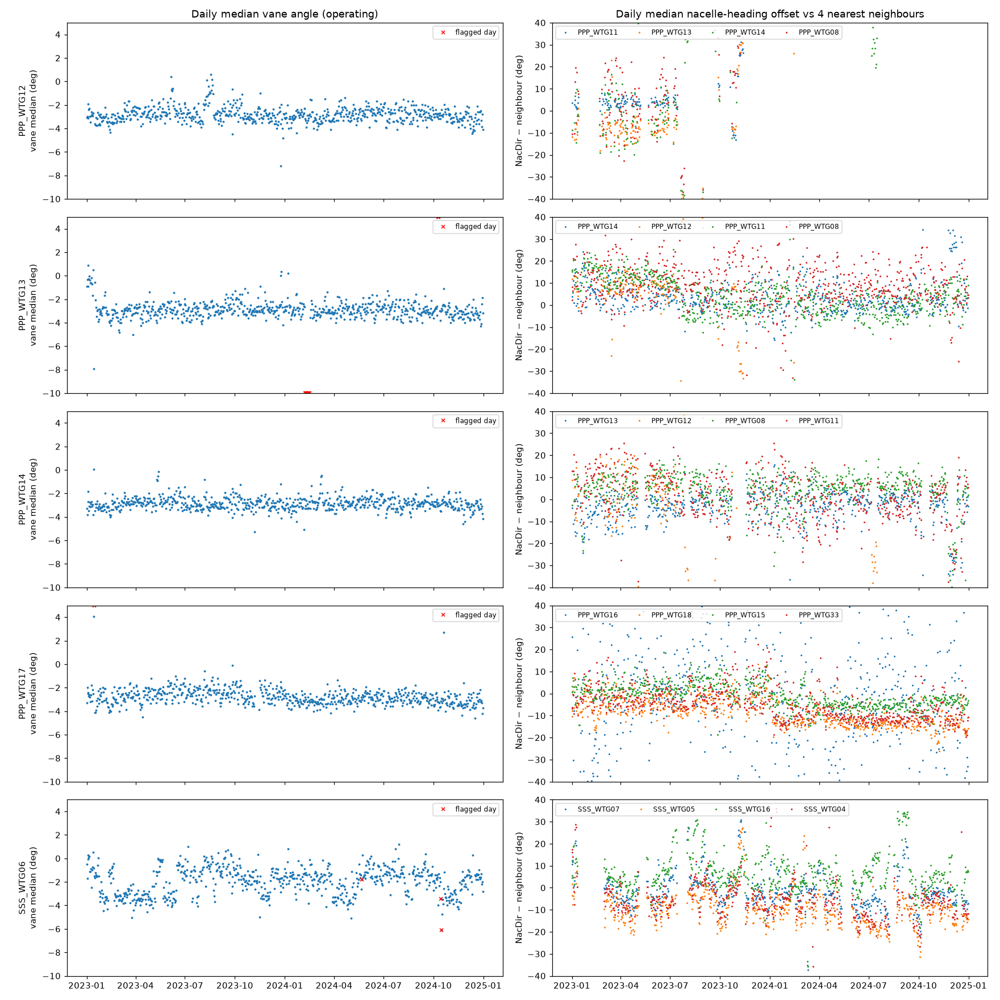
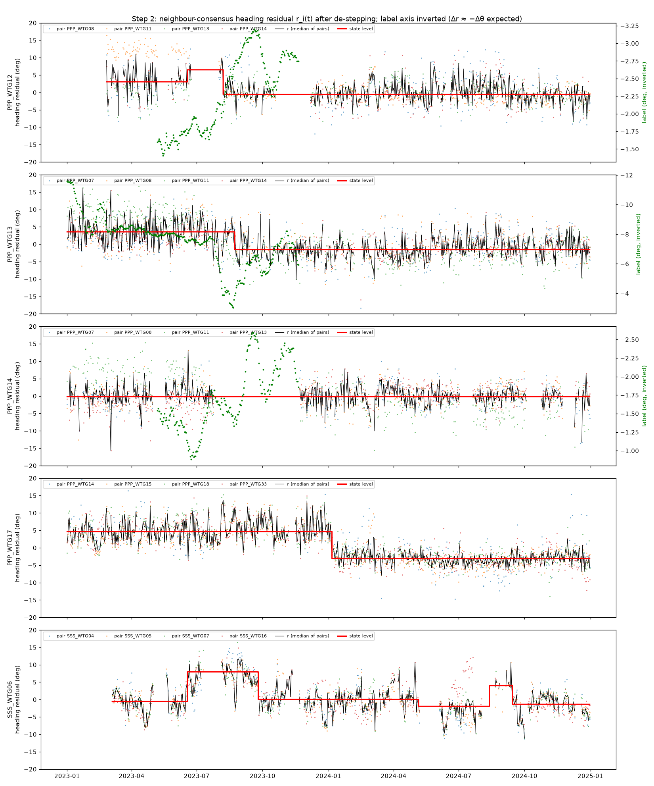
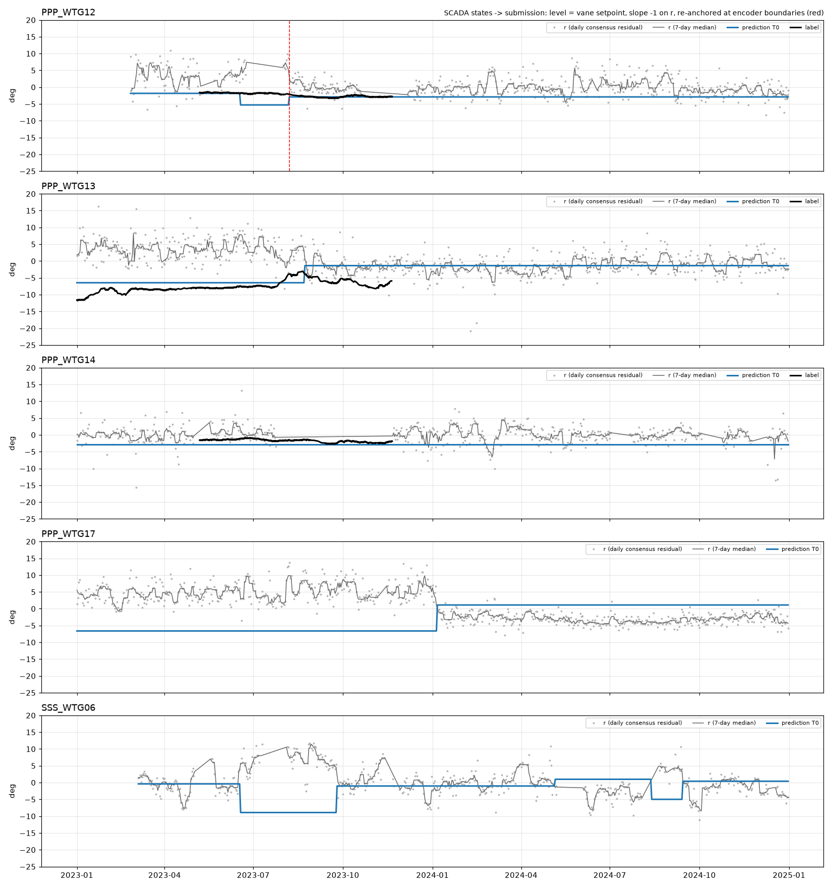

# Participant 33 — final description (T0)

## Team members

Daniel Alznauer and Giuseppe Prezzo

## Summary

This is a T0 submission for PPP-17 (validation round) and SSS-06 (final round).
It fits no parameter to labels and uses no power curve. It reads *changes* of
the static yaw misalignment from how a turbine's nacelle heading moves against
the headings of its four nearest neighbours, and splits the two years into
periods of constant misalignment with a change-point search. The *absolute
level* is not measured: it is assumed to equal the turbine's vane set-point.
The method therefore finds when and by how much the misalignment changed, and
only guesses where it sits.

The method builds on other people's work. The sensor algebra and the idea of
reading misalignment changes from a residual against the neighbours are from
Participant 50's T1_T2_T3 solution; the heading model behind it is in a TNO
report. Our contribution is the label-free implementation: the residual and its
cleaning, the segmentation into states, a treatment of nacelle-encoder faults
that also works on SSS-06, and the vane set-point as level. The table under
*Credits and own contribution* lists who did what.

## Method

**Sensor model** (after Participant 50). The reported nacelle heading is the true heading plus an
unknown encoder offset, $N_r = N + \delta_n$. The yaw controller turns the
nacelle until the vane reads its set-point, so the vane cannot see a static
misalignment $\theta$: its daily median is flat at about −3° on every PPP
turbine, whatever the label says.

**Neighbour heading residual.** Against a consensus $c$ of the wind direction
from the neighbours, the daily mean of $N_r - c$ is

$$
r(d) = -\theta(d) + \delta_n(d) - \kappa ,
$$

with $\kappa$ a constant of the neighbours. As long as the encoder offset does
not move, $\Delta r = -\Delta\theta$: a change of $r$ is a change of the
misalignment in physical degrees, with a slope of exactly −1 and nothing to
fit. The level of $r$ carries no information, because $\delta_n$ and $\kappa$
are unknown. This is Participant 50's consensus anchor; here it is built on
the nacelle heading and read directly.

**How $r$ is built** (10-minute aggregates, circular statistics):

1. Heading difference to each of the 4 nearest same-site neighbours, in bins
   where both turbines operate. Two turbines with unstable headings (PPP-12,
   PPP-16) are excluded as neighbours by hand.
2. Encoder faults. A jump of at least 25° that appears with the same sign in
   most pairs within ±3 days is credited to the turbine's own encoder. Most of
   these are *excursions*: the heading reads about 100° off for a few weeks and
   comes back. Intervals shorter than 45 days are dropped. A shift of 15° or
   more that persists between two long intervals is treated as a re-reference
   and subtracted.
3. Days more than 10° from a pair's 91-day rolling median are dropped as
   transients.
4. The median heading difference per 30° wind-direction sector is subtracted,
   to remove terrain and wake effects.
5. Daily median per pair (a day needs at least 12 bins), then median over
   pairs; a pair with an unusually noisy residual is left out. Day-to-day
   noise is about 2°.

**States.** $r$ is smoothed with a 7-day rolling median and segmented with PELT
(squared-error cost, penalty 400, minimum length 14 days). The states are the
submitted `cluster` column. They are computed from SCADA over all 731 days,
without the template.

**Level.** No label-free estimate of the absolute level survived our tests.
Finding the peak of the power-versus-yaw curve failed: over the controller's
±8° deadband the power changes by only about 2 %, the same size as sector,
turbulence and season effects. The level is therefore a prior: we assume an
unbiased vane, so that $\theta$ equals the vane set-point, measured as the
turbine's median daily vane angle in operation. The state levels of $r$ are
centred on their day-weighted mean and added with slope −1:

$$
\hat\theta(d) = L - \big(\bar r_{\ell(d)} - \alpha\big).
$$

**Use of labels.** No parameter is fitted to labels. They were used for three
things: a sign check (the script refuses to write a file unless the label moves
opposite to $r$ on the training turbines), local scoring, and the choice of one
threshold. The thresholds above are fixed constants, set on SCADA. Labels played a
role in one of them: the PELT penalty was compared at 400 and 800 with the
training score, and 400 was kept. *Results* shows how much the files depend on each threshold.

## Results

Misalignment in degrees, wind direction minus nacelle direction.

| File | Turbine | States | Predicted levels |
|---|---|---|---|
| `Results_33_T0_0.csv` | PPP-17 | 2, boundary 2024-01-06 | −6.6° then +1.1° |
| `Results_33_T0_final.csv` | SSS-06 | 6 | −0.4°, −8.9°, −1.0°, +1.0°, −5.0°, +0.4° |

The SSS-06 boundaries are 2023-06-18, 2023-09-25, 2024-05-06, 2024-08-13 and
2024-09-14.

Scored locally on the three training turbines with the challenge rule: RMSE
2.18°, MAE 1.64°, bias +0.20°, ARI 0.36. The bias per turbine is −1.0° (PPP-12),
+2.3° (PPP-13) and −1.2° (PPP-14). The measured slope of label on $r$ is −1.07, against the −1 the
sensor algebra predicts. These numbers are not a clean hold-out, for the reason
given under *Use of labels*.

**Sensitivity to the thresholds.** Each threshold was varied one at a time around the submitted value (26
variants, `scripts/sensitivity.py`):

| Threshold (submitted) | Varied over | PPP-17 | SSS-06 |
|---|---|---|---|
| PELT penalty (400) | 100 to 1600 | unchanged from 200 to 1600; 5 states at 100 | 3 states from 600 up, 8 to 17 states from 300 down |
| Minimum state length (14 days) | 7, 28 | unchanged | unchanged |
| Smoothing (7 days) | 1, 15 | boundary moves by one day | 6 states at 1 day, 4 at 15 days |
| Encoder attribution (25°) | 15, 20, 35 | unchanged | one boundary moves by two days |
| Re-reference limit (15°) | 10, 20 | unchanged | unchanged |
| Excursion length (45 days) | 30, 60 | unchanged | levels move by up to 1.0°, one boundary by a month |
| Transient limit (10°) | 7, 15 | unchanged | 4 states at 7°, 7 states at 15° |
| Transient window (91 days) | 61, 121 | levels move by 0.1° | levels move by 0.1° |
| Neighbours (4) | 3, 5 | unchanged | levels move by up to 0.4° |
| Sectors (12) | 8, 18 | levels move by 0.3° | levels move by up to 0.8°, one boundary by a month |

- **PPP-17.** 25 of the 26 variants give the same two states, with the boundary
  on 5 or 6 January 2024 and a step of 7.7° to 8.2°. The remaining one
  (penalty 100) keeps that boundary and adds three more.
- **SSS-06, 2023.** The state from mid-June to 25 September 2023 is found in
  25 of the 26 variants, at −8.4° to −9.1°. Penalty 100 splits it into three
  parts between the same two dates.
- **SSS-06, 2024.** These states depend on the thresholds. All three disappear
  for a penalty of 600 or more, and the 32-day state at −5.0° also disappears
  with 15-day smoothing or a 7° transient limit.
- **Training score.** RMSE is 2.02° to 3.17° over the variants (2.18°
  submitted); three variants score better than the submitted one. Over the
  penalty it is 2.33° at 200 and 300, 2.18° at 400 and 2.58° from 600 up.

The one choice informed by labels, the penalty, therefore does not affect the
PPP-17 file. On SSS-06 it decides whether the three states of 2024 appear.

The vane cannot see the misalignment (left); the neighbours can (right, raw
heading differences before cleaning):

The residual per pair (dots), their median $r$ (black) and the state levels
(red). On the training turbines the label is drawn in green on an inverted
axis:

Predictions (blue), residual (grey), label where it exists (black):

Code: <https://github.com/d-er/NADARA-Yaw-Misalignment-Challenge>

## Conclusions

- **PPP-17** changes once, on 2024-01-06, by 7.7°: about −6.6° before, about
  +1.1° after. The date and the step size are the reliable part; both levels
  move together with the assumed set-point.
- **SSS-06** has a clear state at about −8.9° from mid-June to late September
  2023, found in 25 of the 26 threshold settings tried. The three states of 2024
  differ by 1° to 6° and depend on the thresholds. The 32-day state at −5.0°
  falls in a period when two of the four neighbours had encoder excursions of
  their own and is probably not real.

Limitations:

- **The level is an assumption, not a measurement.** It is wrong by the vane's
  own offset, which was 1° to 2.3° on the training turbines and cannot be
  checked on a turbine without a label. A turbine misaligned by a constant
  amount since commissioning is invisible to this method.
- **Small changes are not resolved.** $r$ wanders by up to ±5° over weeks, so
  changes below 3–5° are not reliable. The training labels only contain changes
  of 1–3°; the range where the method works rests on two events (PPP-17,
  SSS-06) whose labels we do not have.
- **The first version failed on the test site.** The validation site never
  exercised the encoder handling, and subtracting estimated jumps left errors
  as large as the signal on SSS-06. Steps 2 and 3 were rewritten after the
  validation round. The PPP-17 file merged on the leaderboard is from the first
  version; the present code reproduces it to within 0.16°.
- **Fixed thresholds.** 25°, 15°, 10°, 45 days, 91 days and the PELT penalty
  were set on five turbines of one type at two sites. The sensitivity table
  shows what they do here; other controllers, encoders and terrain may need
  other values.
- **Encoder faults cost data and can hide a change.** SSS-06 loses 117 of 731
  days to excursions; its first 63 days have no residual and take the value of
  the first state. A real change of 15° or more across an excursion would be
  removed as a re-reference, and a real state shorter than about 45 days that
  departs by more than 10° is deleted as a transient.
- **The high-frequency data is not exploited.** The challenge asks what the
  12-second stream adds over 10-minute SCADA. Our residual is built on
  10-minute aggregates and would work on standard SCADA; the fast data is only
  used to form them. The method says nothing about the yaw dynamics the
  challenge is aimed at.
- **Healthy neighbours are required.** An isolated turbine cannot be assessed,
  and a fault on a neighbour can appear as a state on the target.

We see the method as a screening tool ("the alignment of this turbine changed
by about X° around this date"), not as a replacement for a measurement. For the
organisers' goal of fleet-wide detection without measurement campaigns it shows
one thing: changes of 8–9° can be found and dated from standard 10-minute SCADA
of a turbine and its neighbours, with no labels.

## Credits and own contribution

The idea is Participant 50's; the implementation described in *Method* is ours.

| Element | Source |
|---|---|
| Heading model $N_r = N + \delta_n$, pairwise heading differences, calibration error constant between maintenance steps | TNO report 2020 R11206, §3.4 |
| Full sensor algebra (vane bias, controller nulls the measured vane) | Participant 50 |
| Level not identifiable from SCADA, change identifiable | Participant 50 (TNO for the heading part) |
| Residual against a consensus of the neighbours; slope fixed from the algebra, not fitted | Participant 50 |
| De-stepping the encoders; finding that this matters more than the model | Participant 50 (used in our first version) |
| PELT change-point algorithm | Killick, Fearnhead and Eckley (2012); `ruptures` library |
| Residual built pair by pair on the nacelle heading, sector correction, transient filter, robust medians | ours |
| States from PELT on the residual; encoder-typed boundaries; one anchor per encoder-free segment | ours |
| Encoder excursions masked instead of de-stepped; only persistent shifts corrected | ours |
| Vane set-point as level (an assumption, not a solution of the level problem) | ours |
| Use without labels and without a learned model (T0) | ours |
| Application to SSS-06 and the analysis of why the first version failed there | ours |

References:

- C. Stock-Williams, D. Wouters, M. Maj, *Investigation into automating wind
  turbine underperformance detection using social statistics*, TNO report
  2020 R11206
  ([PDF](https://publications.tno.nl/publication/34637217/7RLl98/TNO-2020-R11206.pdf)).
- Participant 50's T1_T2_T3 solution in this challenge.
- R. Killick, P. Fearnhead, I. A. Eckley, *Optimal detection of changepoints
  with a linear computational cost*, 2012; the `ruptures` Python library.

Code and text were written with the help of an AI coding assistant and
reviewed by the author.

## Next steps

- **Measure the level.** Combine the residual with an encoder-free estimate
  from the power response during yaw manoeuvres.
  Only one number per state is needed, and the states say which days may be
  pooled.
- **Solve the farm jointly.** One piecewise-constant offset per turbine over
  all pairs, in place of a median over four fixed neighbours. This would remove
  the manual blacklist.
- **Uncertainty per state**, from the spread across pairs and days, with a flag
  when a boundary coincides with an encoder excursion.
- **Validation on more labelled turbines**, with changes of 3–10° and a second
  turbine type.

## Disclaimer

The participant takes the responsibility of obtaining any permission to use any
algorithms/tools/data that are intellectual property of third party.
